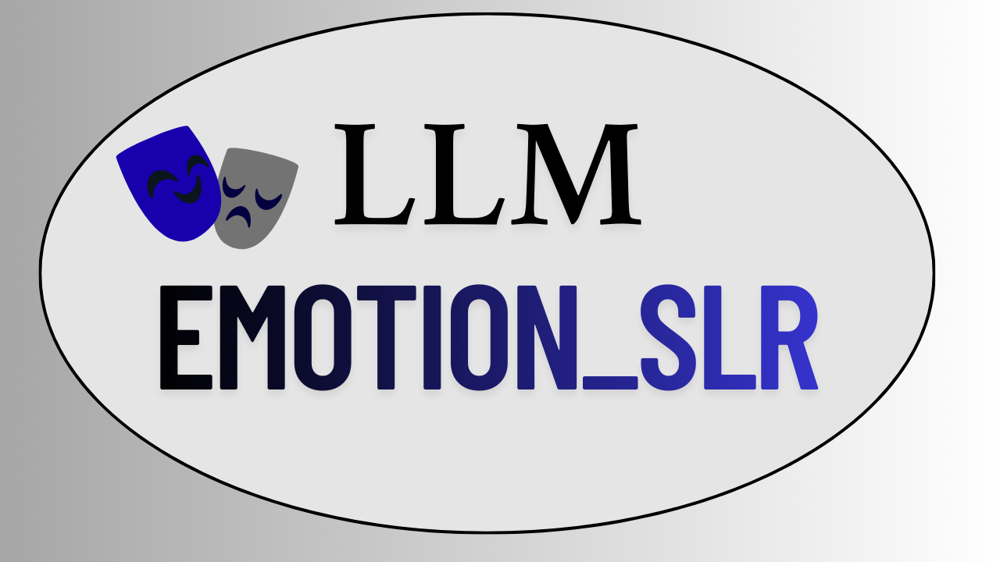

<p align="center">
  
</p>

# Emotion Detection with LLMs: A Dataset-Centric Systematic Review

This repository accompanies the paper:

> **Emotion Detection with LLMs: A Dataset-Centric Systematic Review Revealing Taxonomy Bias and Text-Length Effects**  
> Natasha Tanzila Monalisa, Ranesh Naha, Alistair Barros, James Hughes  
> Under review at *Artificial Intelligence Review*

The repository provides **all non-proprietary materials** required to reproduce,
inspect, and extend the dataset-level and taxonomy-grounded analyses presented in
the paper.

---

## 📌 Scope of the Repository

This repository supports a **systematic literature review (SLR)** of **88 studies** on
LLM-based emotion detection published between **2015–2026**, focusing on:

- Emotion taxonomy coverage (Basic, Composite, Complex)
- Dataset-centric analysis across **57 benchmark datasets**
- Length-wise performance behaviour of LLMs
- Δ-based normalisation against same-study BERT-family baselines
- Explicit extraction of technical and conceptual limitations

The review protocol is registered on OSF: https://doi.org/10.17605/OSF.IO/736NS

---

## 📂 Repository Contents

### `data/`
- **Data_extraction_88_studies.xlsx**: extraction records for all 88 included studies
  (study details, models, datasets, emotion labels and taxonomy codes, performance
  metrics, stated challenges, quality appraisal)

### `results/`
- **bert_family_share_rows.csv**: the 133 study–dataset–metric rows behind the
  BERT-family share and the Δ synthesis (Sect. 4.3.2)

### `appendix/`
- search strings and source-specific search fields (Sect. 3.3, Appendix Table 11)
- quality appraisal scores for all 88 studies (Sect. 3.6, Appendix Table 12)

### `scripts/`
Python scripts used to compute the average text lengths in Table 2
(see `scripts/README.md`).

---

## 🔁 Reproducibility Notes

- No proprietary datasets are redistributed.
- Dataset links and original citations are provided where applicable.
- All derived statistics are computed from publicly available sources.
- Performance values are reported exactly as stated in the original papers.

---

## 📖 Citation

If you use this repository, **please cite the paper**:

```bibtex
@article{Monalisa2026EmotionLLMSLR,
  title   = {Emotion Detection with LLMs: A Dataset-Centric Systematic Review Revealing Taxonomy Bias and Text-Length Effects},
  author  = {Monalisa, Natasha Tanzila and Naha, Ranesh and Barros, Alistair and Hughes, James},
  journal = {-------------------},
  note    = {Under review},
  year    = {2026}
}
```
